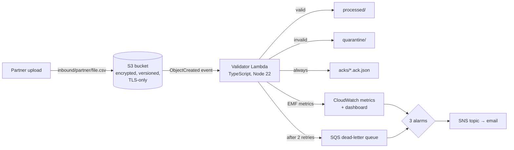
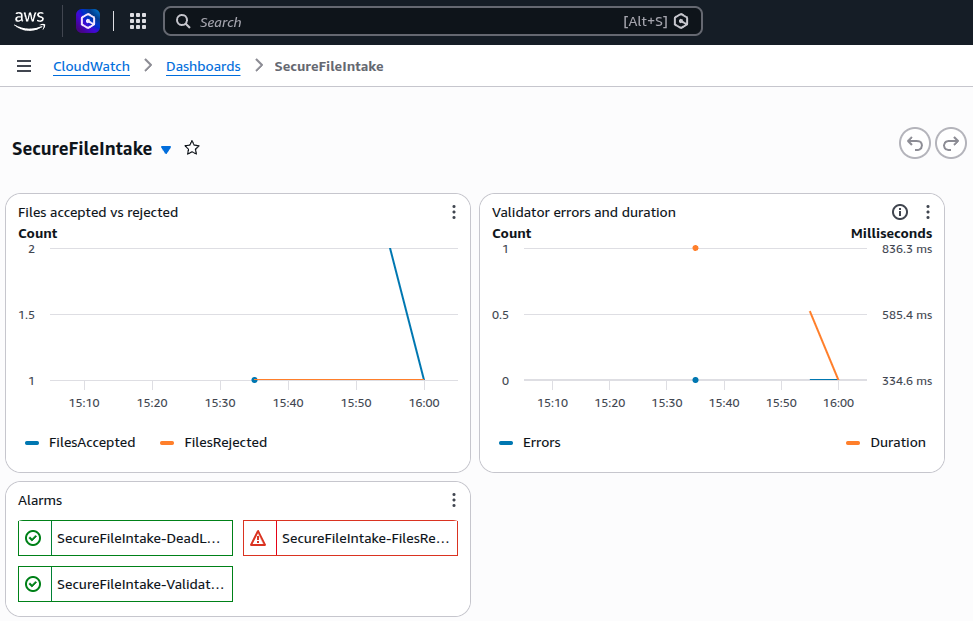
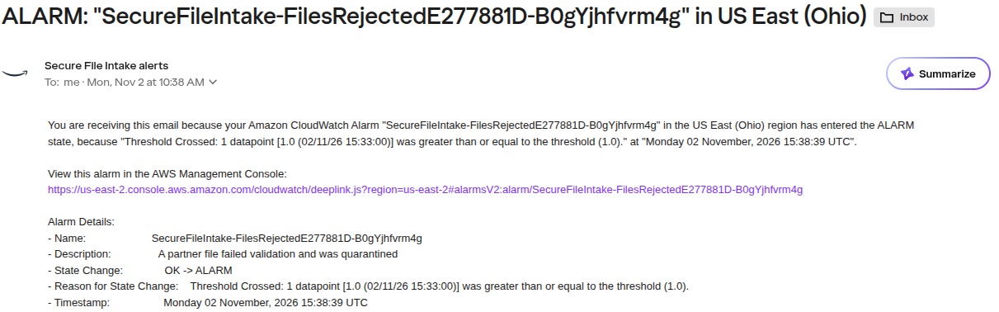

# Secure File Intake

A small, production-minded pipeline for receiving partner data files on AWS: files land in an encrypted S3 drop zone, a TypeScript Lambda validates them, good files move to `processed/`, bad files go to `quarantine/`, every file gets an acknowledgement, and failures page someone.

Infrastructure is defined in **AWS CDK (TypeScript)**, tested with CDK assertions and Jest, and deployed by **GitHub Actions** using OIDC (no stored AWS keys).

## Why I built it

I've spent much of my career moving regulated data between systems: HL7 interface feeds and pharmacy ACKs in healthcare, Connect:Direct and SFTP transfers carrying PHI at a BlueCross BlueShield contractor, and self-healing monitoring for state lottery platforms. This project rebuilds that pattern with cloud-native tooling: infrastructure as code, least-privilege IAM, and alerting built in from the start.

## Architecture



| Prefix | Purpose | Retention |
|---|---|---|
| `inbound/<partner>/` | Partner drop zone; files are removed after processing | — |
| `processed/` | Files that passed validation | 30 days |
| `quarantine/` | Files that failed validation, kept for review | Until reviewed |
| `acks/` | One JSON verdict per file (`ACCEPTED` / `REJECTED` + line-level errors) | 30 days |

## Design decisions

- **Security by default.** S3-managed encryption, all public access blocked, a bucket policy that denies non-TLS requests, versioning, and bucket-owner-enforced object ownership.
- **Least privilege.** The Lambda can read and delete only `inbound/*` and write only to the three output prefixes. A unit test fails the build if delete permission ever leaks beyond `inbound/`.
- **No PHI in logs.** The function logs file names, counts, and verdicts, never file contents.
- **Every file gets an answer.** The ack file works like an X12 999 or HL7 ACK: the sender can always tell whether a file was accepted and why not.
- **Nothing fails silently.** Two automatic retries, then a dead-letter queue. Alarms fire on Lambda errors, any rejected file, and any dead-lettered event.
- **Observability without extra cost.** Metrics are emitted in CloudWatch Embedded Metric Format straight from logs, and a dashboard shows accepted vs. rejected files, errors, and duration.
- **Cheap and disposable.** Serverless only, no NAT gateway or always-on servers. `cdk destroy` removes everything, including bucket contents.

## Validation rules

Files must be CSV with at least these columns: `member_id, first_name, last_name, dob, plan_code`.

- File not empty and under 10 MB
- All required columns present; every row has the same number of columns as the header
- `member_id` is 6–20 letters or digits and unique within the file
- Names and plan code present
- `dob` is a real, past date in `YYYY-MM-DD` format

Errors are reported with line numbers (capped at 50 per file). See `samples/` for a good and a bad file.

## Run it locally

Requires Node.js 22.

```bash
npm install          # creates package-lock.json; commit it (CI uses npm ci)
npm test             # validation unit tests + infrastructure assertions
npx cdk synth        # render the CloudFormation template
```

## Deploy to your AWS account

```bash
aws configure                                   # or use an SSO profile
npx cdk bootstrap                               # one time per account/region
npx cdk deploy -c alertEmail=you@example.com    # confirm the SNS email it sends you
```

Try it, using the bucket name from the deploy output:

```bash
BUCKET=<BucketName output>
aws s3 cp samples/good-eligibility.csv s3://$BUCKET/inbound/acme/good.csv
aws s3 cp samples/bad-eligibility.csv  s3://$BUCKET/inbound/acme/bad.csv
sleep 10
aws s3 ls s3://$BUCKET --recursive
aws s3 cp s3://$BUCKET/acks/acme/bad.csv.ack.json -   # see the line-level errors
```

The bad file should trigger the `FilesRejected` alarm email within about five minutes.

### What it looks like

CloudWatch dashboard: accepted vs. rejected files, Lambda duration (cold vs. warm), and alarm status:



A rejected file triggers the alarm and an email alert:



**Clean up when done:**

```bash
npx cdk destroy
```

## CI/CD with GitHub Actions

`.github/workflows/ci-cd.yml` runs on every push and pull request:

1. Type-check, run all tests, and `cdk synth`
2. On `main` only, deploy to AWS through the `dev` environment (add a required reviewer there for a manual approval gate)

Deployment authenticates with **GitHub OIDC**, so no AWS access keys are stored in GitHub. To enable it:

1. In IAM, add GitHub as an OIDC identity provider (`token.actions.githubusercontent.com`, audience `sts.amazonaws.com`).
2. Create a deploy role that trusts that provider, restricted to this repo's `main` branch, with permission to assume the CDK bootstrap roles (`cdk-*` roles in your account).
3. In the repo settings, add Actions **variables**: `AWS_DEPLOY_ROLE_ARN`, and optionally `AWS_REGION` and `ALERT_EMAIL`.

Until `AWS_DEPLOY_ROLE_ARN` is set, the pipeline runs tests only and skips deployment.
> Note: deployment in my own account runs from the CLI (`cdk deploy`) because an organization guardrail in that account blocks OIDC identity providers. The workflow's OIDC deploy job is ready for any account that allows them.

## Project layout

```
bin/app.ts                        CDK app entry point
lib/secure-file-intake-stack.ts   All infrastructure
lambda/handler.ts                 S3 event handler (routing, acks, metrics)
lambda/validate.ts                Pure validation logic
test/                             Jest unit and infrastructure tests
samples/                          Example good and bad files
.github/workflows/ci-cd.yml       Build, test, and deploy pipeline
```

## Possible next steps

- Put **AWS Transfer Family** (managed SFTP) in front of the bucket so partners connect over SFTP with per-partner keys and home directories
- Per-partner schemas stored in configuration instead of code
- Forward metrics and logs to **Datadog** or **New Relic**
- Customer-managed KMS keys and S3 Object Lock for stricter compliance
- Separate `dev` and `prod` stages with promotion through the pipeline
